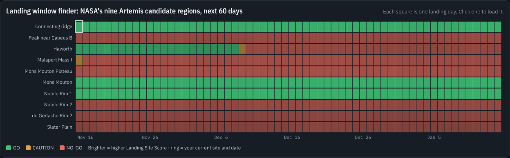

# Lunar Lookout

**NASA Space Apps 2026 · Challenge: Lunar Landing Site Navigator**

**Live app: https://manitkalr1.github.io/lunar-lookout/**

**A weather forecast for Moon landing sites.** Pick a site and a date and get the answer in one line:


Will your lander have power and a line to Earth? Pick any site and date at the lunar south pole. Lunar Lookout shows where the **Sun** (power) and **Earth** (direct radio contact) sit above the site's *real* terrain horizon, built from NASA LRO LOLA laser-altimeter data. It then flies the mission hour by hour and gives the landing a **Landing Site Score from 0 to 100**.


## For judges: try it in 60 seconds

1. Open the [live app](https://manitkalr1.github.io/lunar-lookout/). NASA terrain loads automatically, and the green **Terrain: LOLA 240 m** chip confirms it.
2. Click **Take the 60-second tour**. It walks through the problem, the sky view, the GO call, launch slips, the landing window finder, the ice-filled crater, the 3D view and the validation.
3. Scroll to **How we know it's right** to see the app's results checked live against published science.

## Why it matters

NASA's Artemis astronauts and many robotic landers are heading to the lunar south pole, where water ice survives in craters that never see the Sun. There the Sun never climbs more than about 2° above level and circles the horizon once a month. A single hill can throw a site into days of darkness, and mountains can hide Earth and cut off communication. A site that is perfect on one date can leave a lander dark and silent a week later. Lunar Lookout lets mission planners, students and the public see this for any site and date in seconds.

## Features

- **Mission brief and 60-second guided tour**: walks a first-time visitor from the problem to the answer
- **Horizon view**: the 360° real terrain horizon with the Sun and Earth paths over the whole mission, plus a time slider and Play button
- **Lunar weather forecast**: one plain-language line ("☀️ Sunny, sunset in 87 h · 🌍 Earth hidden, Earthrise in 44 h · Mission call: GO") that updates as you move through time
- **Landing Site Score (0–100) and GO / CAUTION / NO-GO call**: from an hour-by-hour power simulation (solar array, power draw, battery) plus Earth contact. Countdowns show the next sunset and Earthset
- **Landing window finder**: a heatmap of every south-pole site × the next 60 landing days, where each square is a full mission simulation. Click a square to load it
- **Launch-slip analysis**: what a +1 day, +1 week, +2 weeks or +1 month delay changes
- **Site comparison**: up to 5 sites side by side
- **3D terrain view with live shadows**: the real terrain around the site, lit by the true Sun. "Lander's eye" shows the horizon as the lander sees it
- **Live south-pole lighting map**: cast shadows from LOLA terrain; click the map to test any spot
- **"How we know it's right"**: checks the app's results against published science, computed live in the browser
- **Share links and CSV export**: send a colleague the exact scenario, or export hourly Sun and Earth data for analysis
- **Explain mode**: plain-language notes for students and the public

### Landing window finder



### 3D terrain with live shadows


## Landing Site Score

| Part | Points | How it's computed |
|---|---|---|
| Power survival | 40 | 40 × the lowest battery level during the mission. 0 if the battery ever runs flat |
| Communication | 35 | 35 × share of time Earth's centre is above the terrain horizon |
| Sunlight | 25 | 25 × share of time the solar disk clears the terrain horizon |

The power model uses a vertical solar array that turns to face the Sun (the usual design at the poles, where the Sun is always low). The array produces its rated power × the visible fraction of the solar disk, and the battery carries a constant load through every night. The defaults are 450 W of array, a 120 W load and an 8.6 kWh battery (about 3 days of darkness). You can change all three in the app.

## Run it

It's a static site with no build step. Browsers block ES modules on `file://`, so serve the folder:

```bash
python3 -m http.server 8000
```

Then open http://localhost:8000.

To deploy, push to GitHub, then go to **Settings → Pages**, choose the `main` branch and the `/ (root)` folder, and click **Save**.

## Real NASA terrain (built in)

The app ships with NASA's **LRO LOLA** south-pole elevation model `data/LDEM_75S_240M.IMG` (240 m/pixel, 3812×3812, 29 MB) and loads it on startup. The status panel confirms it with a built-in check: *Shackleton floor sits 4.0 km below its rim ✓*.

For sharper detail within 5° of the pole, drop `LDEM_85S_40M.IMG` (115 MB, from the [LOLA polar GDR archive](https://imbrium.mit.edu/DATA/LOLA_GDR/POLAR/IMG/)) onto the terrain panel. Your browser remembers it for next time.

### Results on real terrain vs published science

These are one-year results from 1 Jan 2026, with a 2 m mast. Run `npm run test:real` to reproduce them.

| Site | Sunlight | Earth in view | Longest night | Published reference |
|---|---|---|---|---|
| Connecting ridge | 83% | 51% | 6 days | ~80–90%, nights of days (Mazarico et al. 2011) |
| de Gerlache rim | 54% | 51% | 15 days | |
| Mons Mouton | 46% | 81% | 17 days | |
| Malapert massif | 41% | 66% | 20 days | Malapert peak ~5 km high ✓ |
| Shackleton floor | 0% | 0% | whole year | Permanently shadowed ✓ |
| Haworth floor | 0% | 0% | whole year | Permanently shadowed ✓ |

Shackleton depth from the DEM is 4.0 km (published value: ~4.2 km, Zuber et al. 2012).

**JPL Horizons cross-check:** for the Sun at the connecting ridge (222.69°E, 89.45°S) at 00:00 UTC on 1 Jan 2027, NASA JPL Horizons gives azimuth 40.4333°, elevation 1.4326°. Lunar Lookout gives 40.4303° and 1.4340°, a difference of 0.003° in azimuth and 0.001° in elevation. The reference values and the exact query are in `js/horizons.js`, and the table in the app shows the comparison live.

## How it works

| Step | Method | Code |
|---|---|---|
| Sun and Earth positions | astronomy-engine (VSOP87 / ELP-based, ~1′ accuracy) | `js/ephemeris.js` |
| Moon orientation | IAU/WGCCRE rotation model, which matches LOLA's Mean-Earth frame to well under 0.1° | `js/ephemeris.js` |
| Azimuth / elevation | Local east-north-up frame at the site, including panel height | `js/ephemeris.js` |
| Terrain horizon | Ray-traced every 0.5° of azimuth out to 150 km on the LOLA polar stereographic DEM, including lunar curvature | `js/terrain.js` |
| Sunlight | Fraction of the 0.53° solar disk above the terrain horizon | `js/terrain.js` |
| Metrics, power simulation, score and verdict | Hourly samples across the mission | `js/analysis.js` |
| Charts and map | Canvas 2D | `js/render.js` |
| Heatmap, validation, tour, share links, CSV | | `js/features.js` |
| 3D terrain | three.js mesh from the DEM, per-vertex cast shadows | `js/view3d.js` |

## Tests

```bash
npm install
npm test            # geometry checks against independent models
npm run test:real   # results on the real LOLA terrain vs published facts
```

The tests check:

- the sub-Earth point against astronomy-engine's independent libration model (agrees to within 0.03°)
- the Sun's latitude limit (±1.54° axial tilt)
- near-side and far-side Earth visibility
- the terrain ray tracer against analytic cases (a 2 km wall 20 km away, within 0.1°; a peak whose horizon must dip below level)
- the power model (the battery lasts exactly capacity ÷ load hours; a 14-day equatorial night drains it)
- on the real LOLA data: Shackleton depth, Malapert height, permanently shadowed crater floors, ridge illumination and night length, all against published values

## Data sources

- **LRO LOLA** `LDEM_75S_240M` polar elevation model (NASA PDS Geosciences Node / MIT imbrium mirror), bundled in `data/`
- **astronomy-engine** 2.1.19 and **three.js** 0.170 (both MIT licence), bundled in `vendor/`
- Landing-site coordinates are approximate. Verify them in [LROC Quickmap](https://quickmap.lroc.im-ldi.com/) before quoting.
- **JPL Horizons** can be used to spot-check Sun and Earth positions for any site and time.

## Limitations

- North of 75°S there is no terrain in the bundled file, so those sites (Apollo, Chang'e) use a smooth Moon.
- The 240 m DEM smooths out features smaller than a few pixels. The 40 m file is better for sites within 5° of the pole.
- Earth visibility uses the centre of Earth's disk and doesn't check Deep Space Network station schedules. Sunlight ignores light reflected from nearby terrain.
- The power model is a planning sketch. It uses a constant load and no temperature effects, and the battery starts full.
- The 3D view applies vertical exaggeration (×2 by default) to both terrain and light, so shadows stay correct.

## Team

_Add names and roles._
