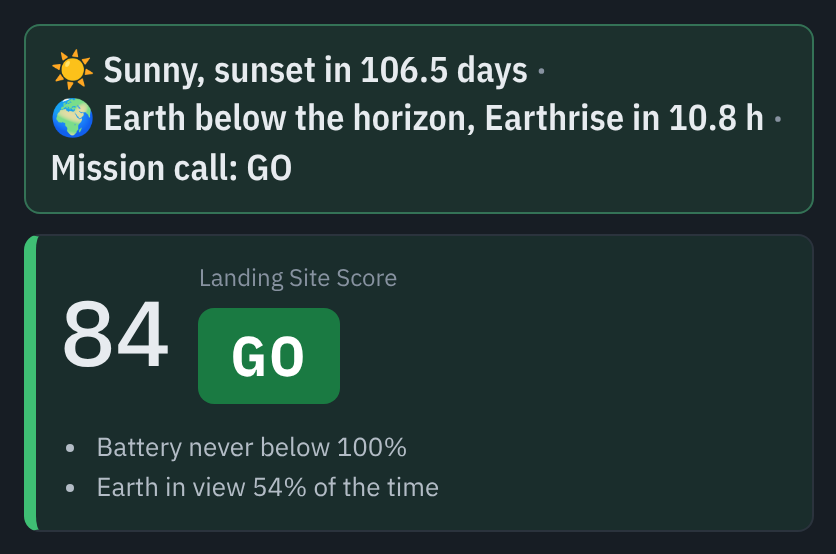
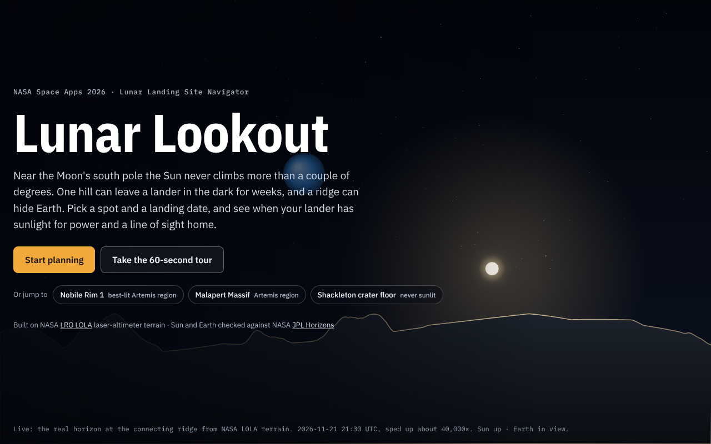
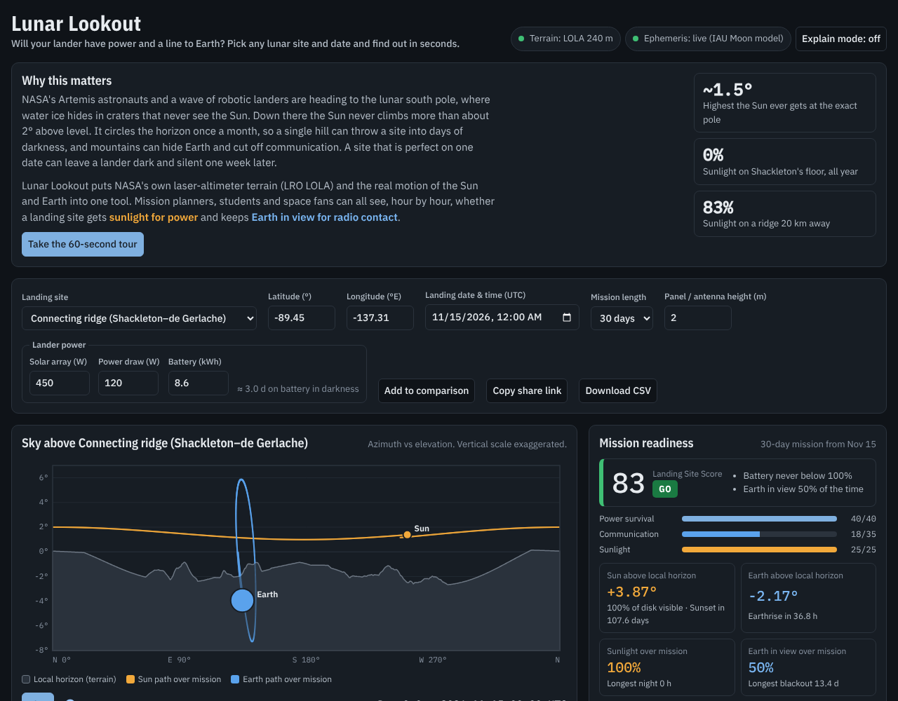
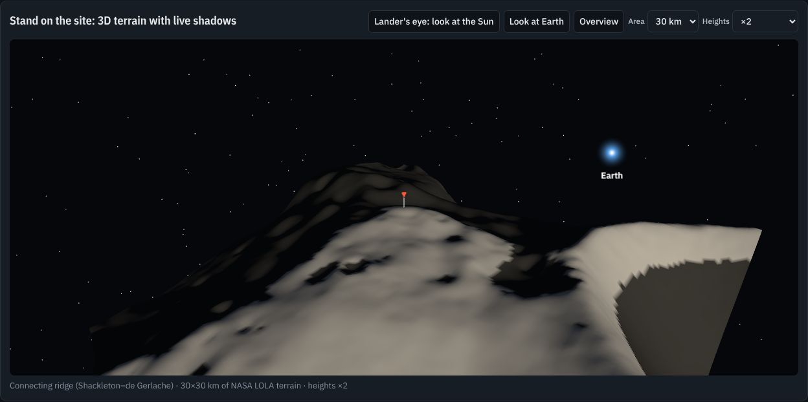

# Lunar Lookout

**NASA Space Apps 2026 · Challenge: Lunar Landing Site Navigator**

**Live app: https://manitkalr1.github.io/lunar-lookout/**

**A weather forecast for Moon landing sites.** Pick a site and a date and get the answer in one line:



Will your lander have power and a line to Earth? Pick any site and date at the lunar south pole. Lunar Lookout shows where the **Sun** (power) and **Earth** (direct radio contact) sit above the site's *real* terrain horizon, built from NASA LRO LOLA laser-altimeter data. It then flies the mission hour by hour and gives the landing a **Landing Site Score from 0 to 100**.





## For judges: try it in 60 seconds

1. Open the [live app](https://manitkalr1.github.io/lunar-lookout/). The title screen shows the real horizon of one south-pole site, built from NASA LOLA terrain, with the Sun moving along its true path. NASA terrain loads automatically, and the green **Terrain: LOLA 240 m** chip in the top bar confirms it.
2. Click **Take the 60-second tour**, or **Start planning** to go straight to the planner. It walks through the problem, the sky view, the GO call, launch slips, the landing window finder, the ice-filled crater, the 3D view and the validation.
3. Scroll to **How we know it's right** to see the app's results checked live against published science.

## Why it matters

NASA's Artemis astronauts and many robotic landers are heading to the lunar south pole, where water ice survives in craters that never see the Sun. There the Sun never climbs more than about 2° above level and circles the horizon once a month. A single hill can throw a site into days of darkness, and mountains can hide Earth and cut off communication. A site that is perfect on one date can leave a lander dark and silent a week later. Lunar Lookout lets mission planners, students and the public see this for any site and date in seconds.

## Features

- **Mission brief and 60-second guided tour**: walks a first-time visitor from the problem to the answer
- **Horizon view**: the 360° real terrain horizon with the Sun and Earth paths over the whole mission, plus a time slider and Play button
- **Lunar weather forecast**: one plain-language line ("☀️ Sunny, sunset in 87 h · 🌍 Earth hidden, Earthrise in 44 h · Mission call: GO") that updates as you move through time
- **Landing Site Score (0–100) and GO / CAUTION / NO-GO call**: from an hour-by-hour power simulation (solar array, power draw, battery) plus Earth contact. Countdowns show the next sunset and Earthset
- **NASA's nine Artemis candidate regions**: Peak near Cabeus B, Haworth, Malapert Massif, Mons Mouton Plateau, Mons Mouton, Nobile Rim 1, Nobile Rim 2, de Gerlache Rim 2 and Slater Plain, each analysed at its best-lit gentle spot
- **Landing window finder**: a heatmap of the nine Artemis regions (plus the connecting ridge) × the next 60 landing days, where each square is a full mission simulation. Click a square to load it
- **Launch-slip analysis**: what a +1 day, +1 week, +2 weeks or +1 month delay changes
- **Site comparison**: up to 5 sites side by side
- **3D terrain view with live shadows**: the real terrain around the site, lit by the true Sun. "Lander's eye" shows the horizon as the lander sees it
- **Live south-pole lighting map**: cast shadows from LOLA terrain; click the map to test any spot
- **"How we know it's right"**: checks the app's results against published science, computed live in the browser
- **Share links and CSV export**: send a colleague the exact scenario, or export hourly Sun and Earth data for analysis
- **Explain mode**: plain-language notes for students and the public
- **Mission advisor (AI chat, Gemini)**: ask questions about what's on screen ("Why is this a NO-GO?", "Which Artemis region is best right now?"). Every question carries a snapshot of the app's current numbers, so answers use the app's own results

### Landing window finder


### 3D terrain with live shadows



## NASA's Artemis candidate regions

NASA named nine candidate landing regions for Artemis on 28 October 2024, published only as outlines on a map. The region centres come from Team AFUQ's open digitisation of that map ([ziyadell/Lunar-Landing-Site-Navigator](https://github.com/ziyadell/Lunar-Landing-Site-Navigator), MIT licence, about 0.5 km accuracy). Inside each region, Lunar Lookout picks its own analysis point: the best-lit spot with slope ≤ 10° within 4 km of the centre, on NASA LOLA terrain over 2027 (`tools/find-region-points.mjs`). These are representative analysis points, not NASA-designated landing sites.

| Region | Analysis point | Sunlight 2027 | Earth in view 2027 |
|---|---|---|---|
| Nobile Rim 1 | 85.543°S, 37.586°E | 82.6% | 61.5% |
| Mons Mouton | 85.481°S, 31.399°E | 76.1% | 55.7% |
| Malapert Massif | 85.992°S, 0.254°E | 65.1% | 76.9% |
| Peak near Cabeus B | 83.592°S, 68.460°W | 62.3% | 67.8% |
| Slater Plain | 87.223°S, 127.309°E | 60.9% | 33.5% |
| Haworth | 86.769°S, 20.588°W | 52.3% | 63.0% |
| Nobile Rim 2 | 84.043°S, 59.286°E | 52.0% | 71.6% |
| Mons Mouton Plateau | 84.279°S, 29.918°E | 51.7% | 100.0% |
| de Gerlache Rim 2 | 88.310°S, 62.095°W | 42.9% | 49.8% |

## Mission advisor (AI chat)

The **Ask the advisor** button opens a chat powered by Google Gemini (`gemini-3.8-flash`). With each question the app sends a compact snapshot of what you're looking at: the site, dates, forecast, score breakdown, battery simulation, best landing days, and NASA's long-term values. The advisor answers with those numbers and says when something isn't in them. Replies are shown as plain text with basic formatting, never as raw HTML. Code: `js/chat.js`.

The site is public, so it never contains an API key. There are two ways to connect:

- **For everyone, recommended:** deploy the small Cloudflare Worker in [`worker/`](worker/README.md). It holds your Gemini key as a secret, accepts only this site, caps message sizes and rate-limits. Then set `CHAT_PROXY_URL` in `js/config.js`.
- **Without the Worker:** the advisor asks each visitor for their own Gemini API key, kept only in their browser.

AI answers can be wrong, and the panel says so.

## Landing Site Score

| Part | Points | How it's computed |
|---|---|---|
| Power survival | 40 | 40 × the lowest battery level during the mission. 0 if the battery ever runs flat |
| Communication | 35 | 35 × share of time Earth's centre is above the terrain horizon |
| Sunlight | 25 | 25 × share of time the solar disk clears the terrain horizon |

The power model uses a vertical solar array that turns to face the Sun (the usual design at the poles, where the Sun is always low). The array produces its rated power × the visible fraction of the solar disk, and the battery carries a constant load through every night. The defaults are 450 W of array, a 120 W load and an 8.6 kWh battery (about 3 days of darkness). You can change all three in the app.

## Run it

**Easiest:** open the [live app](https://manitkalr1.github.io/lunar-lookout/). It works on any device with a modern browser.

**From a copy of this repo, with no setup:** double-click `index.html`. Browsers block multi-file web apps opened from disk, so the page automatically switches to a single-file build of the same code (`dist/lunar-lookout.js`). Browsers also won't let a local page read the terrain file by itself, so the app asks you once to choose `data/LDEM_75S_240M.IMG` from the app folder. After that it remembers the file.

**From a copy, like the live site (no prompt):** serve the folder, then open http://localhost:8000.

```bash
python3 -m http.server 8000
```

**Deploying:** push to GitHub, then go to **Settings → Pages**, choose the `main` branch and the `/ (root)` folder, and click **Save**.

**After editing anything in `js/`:** run `npm run build` to refresh the single-file build. `npm test` fails if you forget.

## Real NASA terrain (built in)

The app ships with NASA's **LRO LOLA** south-pole elevation model `data/LDEM_75S_240M.IMG` (240 m/pixel, 3812×3812, 29 MB) and loads it on startup. The status panel confirms it with a built-in check: *Shackleton floor sits 4.0 km below its rim ✓*.

For sharper detail within 5° of the pole, drop `LDEM_85S_40M.IMG` (115 MB, from the [LOLA polar GDR archive](https://imbrium.mit.edu/DATA/LOLA_GDR/POLAR/IMG/)) onto the terrain panel. Your browser remembers it for next time.

### Results on real terrain vs published science

These are one-year results from 1 Jan 2026, with a 2 m mast. Run `npm run test:real` to reproduce them.

| Site | Sunlight | Earth in view | Longest night | Published reference |
|---|---|---|---|---|
| Connecting ridge | 83% | 51% | 6 days | ~80–90%, nights of days (Mazarico et al. 2011) |
| de Gerlache rim | 54% | 51% | 15 days | |
| Mons Mouton | 46% | 81% | 17 days | |
| Malapert massif | 41% | 66% | 20 days | Malapert peak ~5 km high ✓ |
| Shackleton floor | 0% | 0% | whole year | Permanently shadowed ✓ |
| Haworth floor | 0% | 0% | whole year | Permanently shadowed ✓ |

Shackleton depth from the DEM is 4.0 km (published value: ~4.2 km, Zuber et al. 2012).

**NASA long-term illumination maps:** NASA's LOLA team publishes 18.6-year average maps of sunlight and Earth visibility ([PGDA product 69](https://pgda.gsfc.nasa.gov/products/69), `AVGVISIB_75S_120M_201608`, Mazarico et al.). Lunar Lookout runs the same 18.6 years (6-hour steps, observer at the surface) at all 15 south-pole sites and compares. Sunlight agrees at 15 of 15 sites (mean difference 7.4 points). Earth visibility also agrees at 15 of 15 (mean difference 5.9 points), counted like NASA, where any part of Earth's disk counts as visible. "Agrees" means within the range NASA's map shows within ±120 m of the point, ±4 points, because values change sharply across ridges. The remaining differences come mostly from our coarser 240 m terrain, which smooths small horizon features. NASA's values are in `js/nasamaps.js`; regenerate them with `tools/extract-nasa-illumination.py`.

| Site | Sunlight: Lunar Lookout / NASA (±120 m range) | Earth: Lunar Lookout / NASA (±120 m range) |
|---|---|---|
| Connecting ridge | 77% / 68% (51–85%) | 57% / 52% (44–58%) |
| Nobile Rim 1 | 79% / 71% (55–84%) | 70% / 62% (43–71%) |
| Malapert Massif | 64% / 60% (39–66%) | 85% / 78% (55–100%) |
| Mons Mouton Plateau | 53% / 54% (48–54%) | 100% / 100% (93–100%) |
| South Pole, Shackleton rim | 35% / 38% (26–39%) | 55% / 55% (55–55%) |
| Shackleton floor | 0% / 0% | 0% / 0% |

**JPL Horizons cross-check:** four reference positions pulled from the NASA JPL Horizons API (DE441), compared with the app at the same site and time on the 1737.4 km sphere. Queries are in `js/horizons.js`.

| Reference (00:00 UTC) | JPL Horizons az / el | Lunar Lookout az / el | Difference |
|---|---|---|---|
| Sun, Connecting Ridge, 1 Jan 2027 | 40.4333° / 1.4326° | 40.4303° / 1.4340° | 0.003° / 0.001° |
| Earth, Connecting Ridge, 1 Jan 2027 | 144.4607° / −6.6957° | 144.4582° / −6.6958° | 0.003° / 0.000° |
| Sun, Malapert, 1 Jan 2027 | 260.1693° / 0.3323° | 260.1662° / 0.3334° | 0.003° / 0.001° |
| Sun, Connecting Ridge, 1 Jul 2027 | 354.0891° / −0.3224° | 354.0888° / −0.3209° | 0.000° / 0.002° |

## How it works

| Step | Method | Code |
|---|---|---|
| Sun and Earth positions | astronomy-engine (VSOP87 / ELP-based, ~1′ accuracy) | `js/ephemeris.js` |
| Moon orientation | IAU/WGCCRE rotation model, which matches LOLA's Mean-Earth frame to well under 0.1° | `js/ephemeris.js` |
| Azimuth / elevation | Local east-north-up frame at the site, including panel height | `js/ephemeris.js` |
| Terrain horizon | Ray-traced every 0.5° of azimuth out to 150 km on the LOLA polar stereographic DEM, including lunar curvature | `js/terrain.js` |
| Sunlight | Fraction of the 0.53° solar disk above the terrain horizon | `js/terrain.js` |
| Metrics, power simulation, score and verdict | Hourly samples across the mission | `js/analysis.js` |
| Charts and map | Canvas 2D | `js/render.js` |
| Heatmap, validation, tour, share links, CSV | | `js/features.js` |
| 3D terrain | three.js mesh from the DEM, per-vertex cast shadows | `js/view3d.js` |

## Tests

```bash
npm install
npm test            # geometry checks against independent models
npm run test:real   # results on the real LOLA terrain vs published facts
```

The tests check:

- the sub-Earth point against astronomy-engine's independent libration model (agrees to within 0.03°)
- the Sun's latitude limit (±1.54° axial tilt)
- near-side and far-side Earth visibility
- the terrain ray tracer against analytic cases (a 2 km wall 20 km away, within 0.1°; a peak whose horizon must dip below level)
- the power model (the battery lasts exactly capacity ÷ load hours; a 14-day equatorial night drains it)
- on the real LOLA data: Shackleton depth, Malapert height, permanently shadowed crater floors, ridge illumination and night length, all against published values
- against NASA's 18.6-year illumination and Earth-visibility maps at 15 sites, and four JPL Horizons positions
- the Mission advisor and its Worker with Gemini mocked: request format, reply parsing, HTML escaping, error messages, key never sent from the browser in proxy mode, site-only access, size limits and rate limiting

## Data sources

The app has an in-page **NASA data and resources** table listing every resource from the challenge and how it is used. Summary:


- **NASA Artemis candidate regions** (28 Oct 2024). Centres digitised by Team AFUQ (MIT licence), see above
- **LROC QuickMap** and **NASA Moon Trek** for checking sites against imagery
- **LRO LOLA** `LDEM_75S_240M` polar elevation model (NASA PDS Geosciences Node / MIT imbrium mirror), bundled in `data/`
- **astronomy-engine** 2.1.19 and **three.js** 0.170 (both MIT licence), bundled in `vendor/`
- Landing-site coordinates are approximate. Verify them in [LROC Quickmap](https://quickmap.lroc.im-ldi.com/) before quoting.
- **JPL Horizons** can be used to spot-check Sun and Earth positions for any site and time.

## Limitations

- North of 75°S there is no terrain in the bundled file, so those sites (Apollo, Chang'e) use a smooth Moon.
- The 240 m DEM smooths out features smaller than a few pixels. The 40 m file is better for sites within 5° of the pole.
- Earth visibility uses the centre of Earth's disk and means a clear line of sight. As NASA's Lunar Surface Propagation work notes, terrain also affects radio, so a real link depends on antenna height, power and Deep Space Network coverage. Sunlight ignores light reflected from nearby terrain.
- The power model is a planning sketch. It uses a constant load and no temperature effects, and the battery starts full.
- The 3D view applies vertical exaggeration (×2 by default) to both terrain and light, so shadows stay correct.

## Team

| Name | Role | Focus |
|---|---|---|
| **Manit Kalra** | Mission Analysis & Software Lead | Orbital geometry and terrain-horizon engine, power simulation and Landing Site Score, validation against JPL Horizons and NASA's illumination maps, app architecture and deployment |
| **Reyansh Parekh** | Product, Science Communication & Data Lead | Challenge requirements and app specification, NASA data sourcing (LOLA, Artemis candidate regions), the lunar weather forecast and user experience, demo and presentation |

Built for the NASA Space Apps Challenge 2026.
